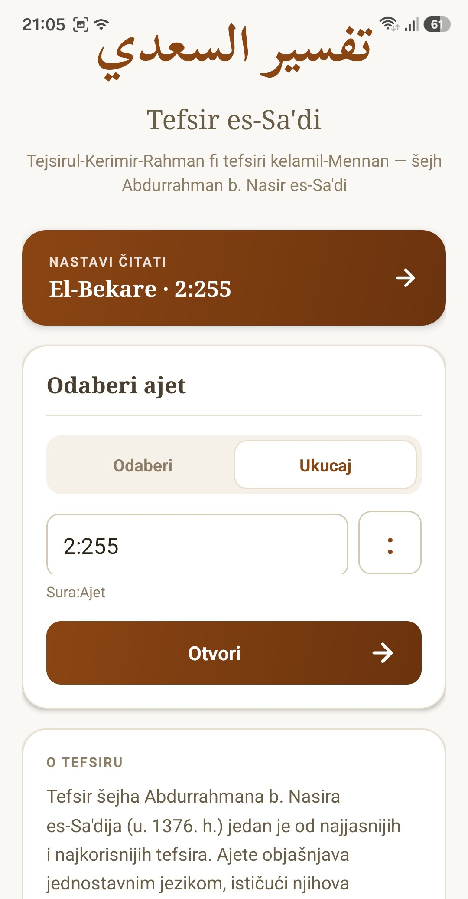
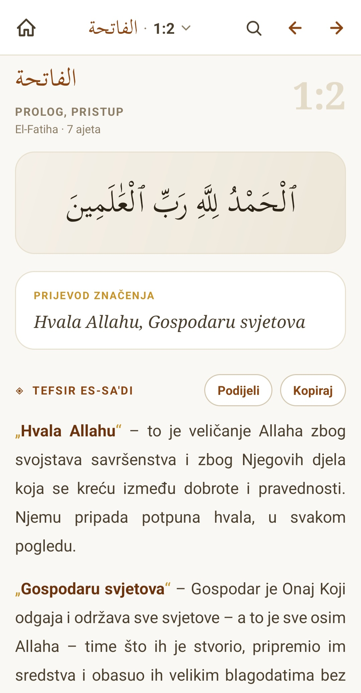

# Tefsir es-Sa'di na bosanskom

**🌐 Web:** [tefsir.pages.dev](https://tefsir.pages.dev)  
**📱 Android:** [preuzmi najnoviju verziju (APK)](../../releases/latest)

Tefsir šejha Abdurrahmana b. Nasira es-Sa'dija (*Tejsirul-Kerimir-Rahman fi tefsiri kelamil-Mennan*) na bosanskom jeziku: arapski tekst ajeta, prijevod značenja i tumačenje svakog ajeta. Prijevod značenja ajeta usklađen je s tefsirom šejha.

  
  &nbsp;
  

## Sadržaj

| Folder | Opis |
|---|---|
| `web/` | Web aplikacija (React, Vite, TypeScript) |
| `web/public/data/` | Podaci po surama: arapski tekst, prijevod značenja, tefsir (arapski i bosanski) |
| `web/prijevod/` | Bosanski prijevod tefsira po surama |
| `web/izvor/tafsir_sadi_official.json` | Arapski original Sa'dijevog tefsira |
| `android/` | Android aplikacija (Kotlin), radi bez interneta |

## Pokretanje

**Web:** `cd web` → `npm install` → `npm run dev` (ili `npm run build` za objavu iz `dist/`)

**Android:** otvori folder `android/` u Android Studiju, sačekaj Gradle Sync, pa pokreni s **Run ▶** (telefon ili emulator). APK: **Build → Generate Signed App Bundle / APK**.
